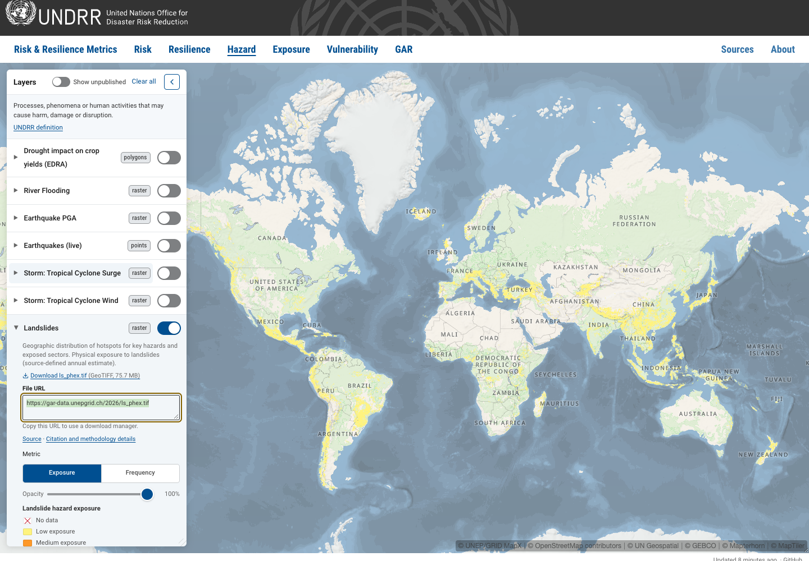

# Data downloads (prototype)

Map data downloads are enabled by default in standalone and embedded viewers.

## Repository kill switch and per-viewer opt-out

Set `MAP_DOWNLOADS_ENABLED = false` in `src/config/features.js`, then rebuild and redeploy, to
hide user-facing map download controls everywhere. This disables GeoTIFF links, generated CSV
buttons and their dialogs. Neither `?downloads=1` nor `{ downloadsEnabled: true }` can override
this repository switch. Set it back to `true` and redeploy to restore downloads.

For one viewer, use `?downloads=0` (or `false`) before the hash, or
`createRiskMap(root, { downloadsEnabled: false })`. Embeds accept `&downloads=0` and preserve the
resolved setting in their full-viewer links. Explicit `1`/`true` remains supported while the
repository switch is on; blank, unknown or repeated values disable that instance.

This is a UI switch, not an access restriction on publicly hosted files. The layer-inventory
CSV export on Sources is separate and remains available.

### Try a download

Start the viewer with the [README development setup](../README.md#developing) and enter the
stakeholder preview PIN when prompted (access details are shared separately).

1. Open `http://localhost:3001/#risk-resilience?layers=recovery-speed` and wait for the
   layer to load. In its expanded row, choose **Download CSV**. The file contains values for the
   selected source; use the row's source selector to download another variant.
2. Wait for **Download started**, then choose **Done**. Closing the dialog or pressing Escape during
   the fetch cancels the download. If the map briefly blanks behind the dialog, it is reading a
   temporary reference view for region names.
3. For a hosted raster, open `http://localhost:3001/#hazard?layers=landslides` and choose
   the GeoTIFF link in the expanded row. The link shows the file's size; files over 1 GB ask for
   confirmation first. Beneath each GeoTIFF link, **File URL** shows the hosted file’s full
   address in a read-only field. Select and copy it to use an alternate download manager;
   copying the URL does not start a download. CSVs are generated in the browser and have no
   hosted file URL.



The CSV dialog names the current stage (fetching, preparing, starting) and uses an
indeterminate Mangrove progress bar: the map service does not report bytes or time
remaining, and the stages are not equal portions of the wait. A fetch still pending
after 10 seconds shows a one-off reminder to keep the dialog open or cancel. This
is guidance, not an estimate or an indication that the service has stalled. The
hint clears on the next stage, error, cancellation or retry. Mangrove supplies the
static reduced-motion and forced-colour rendering of the indicator.

You can also start from Sources: choose a published dataset name to open its map, then download
from the layer row.

## What is offered

| Layer kind                         | Download                                   | Where it comes from                                              |
| ---------------------------------- | ------------------------------------------ | ---------------------------------------------------------------- |
| Raster views with a hosted file    | A link to each GeoTIFF, with format & size | Files hosted by UNEP/GRID-Geneva at `gar-data.unepgrid.ch/2026/` |
| Reviewed region-level vector views | "Download CSV": values per region          | Generated in the browser from the view's MapX attribute table    |
| Everything else                    | Nothing; keeps "Request data" where shown  | –                                                                |

Downloads appear in the layer panel for the view shown (a compound layer's selected source). In that
panel, a view with a download no longer shows "Request data"; a view without one keeps it.

Sources contains attribution rather than per-map download controls. Click a published dataset name
to open it in the viewer, where downloads are available when enabled. Rows for individual variants
open that exact source; grouped dataset rows open the default source. Unpublished entries have no
viewer link. The layer-inventory CSV export remains at the bottom of Sources.

Clicking a file over 1 GB first opens a confirmation dialog (the same dialog the CSV uses) that
gives the size and recommends a fast, unmetered connection; the download starts only on "Download".
Smaller files download straight away. Every file link (and the download a confirmation starts) opens in
a **new tab** (`target="_blank" rel="noopener"`). The files come from another origin, where browsers
ignore the `download` attribute, and the server sends `content-type: image/tiff` without
`Content-Disposition: attachment`. Depending on the browser, the file may download or display in
the new tab. The viewer stays open in its original tab.

## Where the data lives

### Hosted files

`data/inventory.csv` has two optional columns, supplied together:

- **Download URL**: one or more https URLs, separated by `;`.
- **Download size (bytes)**: the matching sizes, in the same order.

`scripts/import-inventory.mjs --apply` writes them to the view's config as
`downloads: [[url, bytes], ...]` (a simple layer, or one compound source). Tuples rather than objects
because the importer matches source objects textually and must not meet nested braces. Sizes are
stored, not fetched, so drawing a link costs no request; `yarn test:downloads-contract` checks them
against the server. `validateLayers()` rejects anything that is not `[https URL, positive integer]`, and
the inventory export writes the two columns back out.

The list came from GRID (one row per raster view, 20 views, one layer group with two files). One URL
was wrong in the supplied list: the 475-year PGA file is `PGA_475y.tif`, not `PGA_450y.tif`.

### CSV eligibility

Per view, in the inventory: the **CSV download** column of `data/inventory.csv` holds

- `yes`: offered as a CSV;
- `no: <reason>`: checked and refused, with the reason (for example, not region-level);
- blank: not reviewed, so **no CSV**. A new vector map gets no CSV until someone vets it with
  `yarn test:downloads-contract --view <id>` and marks it `yes`.

`scripts/import-inventory.mjs --apply` writes it to the view's config as `csvDownload` (the layer for a
simple layer, the compound source for a compound one), the inventory export writes it back, and
`validateLayers()` rejects any other value, or `yes` on a layer that is not vector. `isCsvEligible()`
also requires the layer to be published and not external. The `no:` reasons describe the data, never a
place.

Two developer-level settings stay in `src/config/downloads.js`:

- `REGION_CODE_SOURCES`: one view, `MX-MDFMH-34XOD-EU9HN` (recovery speed, flood Q5), has no region
  code column in its attribute list. Its sibling flood Q1 view reads the same MapX source (same source
  id, same 260 rows), so the codes are borrowed from it, matched row by row on `gid`
  (`attachRegionCodes()`). If the two tables ever differ, the download fails with an error rather than
  guess. GRID could still add the column to the view.
- `REGION_NAME_REFERENCE_VIEW`: the `maplab` view region names are read from (see below).

The views marked `no:` today are the four that are not region-level (grid cells, river basins, forest
classes): values without geometry identify nothing.

## The CSV

Built by the pure `buildRegionCsv()` in `src/utils/region-csv.js`.

- **Columns:** `region_code`, `region_name`, then the value. Only joined value attributes (`jN_…`) are
  exported, as a whitelist: a column MapX might add later (geometry, coordinates, timestamps) cannot
  become a value. One value column is named after the view's label in our config (layer label, plus the
  compound source label); several are named by attribute with the `jN_` prefix removed, keeping the full
  name where the short one would repeat another header.
- **Region names:** `maplab` (the UN map label). `name_en` is never used: it holds romanised local
  names joined with `#`. About 40 views carry only `name_en`; for those, names are read at runtime from
  another view on the same boundary table that does carry `maplab` (`REGION_NAME_REFERENCE_VIEW`), and
  kept in the browser (memory and localStorage, 30 days), so the extra read is rare. A code with no label
  there is left blank, and the file's header and the dialog say how many: "Region names: … N of M
  regions have no name in the map service". That notice is quiet (no retry: retrying would not change
  it). If the lookup itself fails the file still downloads with an empty name column, its header says
  so, and the dialog shows a notice with **Try again**. No list of names is kept in this repository.
- **Region codes:** the geographic area code from the map's boundary table: ISO 3166-1 alpha-3 where
  one exists, and the map service's own code (codes starting with `x`) for the few other areas. Every
  area the map shows a value for is exported, as on the map, and the header carries the standard UN
  disclaimer on the designations used (`UN_DISCLAIMER`).
- **Rows dropped:** rows with no value in any joined value column (null, blank, MapX's `$NULL`, NaN
  or Infinity); rows with no usable code (missing, blank, or not 2–8 letters and digits); and a code
  repeated after its first retained row. `gid` (an internal id) is never written.
- **Format:** UTF-8 with a byte-order mark (so Excel reads accented names), CRLF line ends, RFC 4180
  quoting. Text that a spreadsheet would run as a formula gets a leading apostrophe.
- **Filename:** `<layer-key>_<view-id>.csv`, e.g. `gar26-aal-crops_MX-UN9Z8-4M5QH-PMDNX.csv`.

### Metadata: a header block, not a sidecar

The file starts with one line per field, `#,Label: value` (the second cell is quoted when needed),
taken from our layer config: title, description, source, source URL, citation, license, MapX view ID,
layer key, download date (UTC), the
viewer the file came from (the viewer's base URL, without the query or hash, including for an embed),
how region names were sourced, and a note that boundaries are not included. The `#` stays outside
the quotes so comment options skip the line; the rest is one formula-defused CSV cell, so a citation's
commas stay in one spreadsheet cell. One download carries its own attribution, and browsers do not prompt about a
second file. Data tools skip the block with a comment option:

```python
import pandas as pd

data = pd.read_csv("file.csv", comment="#")
```

```r
read.csv("file.csv", comment.char = "#")
```

Spreadsheets show the block as the first rows. MapX's own view metadata is not used: it has no
human-readable labels, units or citations for most views, and `get_view_meta` includes editor emails.

## How the CSV is generated

`createDownloads()` (`src/ui/downloads.js`) runs the flow behind a "Download CSV" button, in a
progress dialog (`src/ui/download-dialog.js`):

1. **Fetching data:** wait for MapX to be ready (up to 30 s while it is loading; at once, with an
   **Open the map** button, where it cannot load because the map does not warm up behind information
   pages on this device), then read the table with `get_view_table_attribute` (`src/sdk/table.js`).
   Every SDK call has a deadline.
2. **Processing:** build the CSV.
3. **Downloading:** save it through a temporary link; the dialog then says how many regions it holds.

Errors (timeout, MapX failure, a table without region codes) show in the dialog with **Try again**.
Closing the dialog cancels the run: every MapX call checks first, so nothing more is requested except
removing a view the run already added, and nothing is downloaded.

### Views that are not on the map

MapX answers `get_view_table_attribute` only for a view loaded in the session. A view that is not is
added for the read and removed again, outside the layer controller:

- the layers store is never written, so the switch, the URL and `openViews` do not see it;
- it is added with `zoomToView: false`, so the camera does not move;
- the map frame is hidden (opacity 0, so it keeps rendering) from just before the add until the view is
  removed. MapX paints a view before `view_add` answers, so it cannot be made transparent in time:
  setting transparency 100 straight after the add still let one frame of the whole layer through
  (measured). The dialog's backdrop covers the map meanwhile;
- before removing it, the sidebar is asked whether a layer record now wants that view (the user turned
  the layer on meanwhile); if so it stays;
- an add that misses its deadline is removed if it lands later;
- views the session has loaded (on the map now or earlier, or added for a previous read) are read
  without another add.

In the layer panel a row's downloads are only visible while the layer is on (expanding a row turns it
on), so the target view is normally read without an add. Temporary adds serve the region-name and
region-code reference reads, and programmatic `requestCsv(viewId)` calls for unloaded views. The
download flow leaves layer selection, URL state and camera position unchanged.

### Accessibility

The dialog is a native `<dialog>` opened with `showModal()` (the rest of the page becomes inert). It
also keeps Tab inside itself, closes on Escape and returns focus to the button that opened it. Each
state is spoken through a live region from the app's announcer (`createLayerAnnouncer`), placed
inside the dialog: a modal makes everything outside it inert, which would silence the sidebar's own
region while the dialog is open. The header's ✕ is named "Close dialog"; the action button reads
Cancel, Done or Close by state.

Each download control has its own accessible name, starting with its visible words
("Download CSV: Losses to housing – AAL Current (values per region)"). The large-file confirmation is the same
modal dialog, so it gets the same focus handling and announcement.

## Maintenance

After changing the inventory, **import it** before checking the resulting configuration:

```sh
node scripts/import-inventory.mjs           # dry run: review the report
node scripts/import-inventory.mjs --apply
yarn test:downloads-contract                # live: hosted files, MapX views, region-name reference
yarn test
```

`yarn test:downloads-contract` is the way to vet a view or file. Like `test:edra-contract` and
`test:mapx-raster-contract` it calls live services, so it does not run in `yarn test` or CI. It fails
with one line per problem, naming the view or file. `--view <MX-id>` (or `--view=<MX-id>`, repeatable)
also vets a view that is not in the config or not marked `yes` yet; `--skip-files` skips the HEAD
requests. Any other argument is refused.

The check reads live view definitions and file headers, not attribute-table rows. Before marking a
view `yes`, confirm that its values describe geographic regions and try its CSV in the viewer after
importing. A passing check alone does not establish region-level meaning, names or units. New and
renamed CSV views can be checked with `--view` **before** import; run the full check again afterwards.

The importer's guards, each of which stops `--apply` before anything is written:

- **Removals** (`--allow-removals` to proceed): a view left with fewer hosted files than configured, or a
  `yes` CSV turned off. A spreadsheet that keeps the download columns but loses their values (a common
  copy-paste accident) would otherwise clear every view's downloads. Leaving the columns out altogether
  keeps the configured values; a replaced URL is an ordinary update.
- **Re-vetting** (`--csv-vetted` to proceed): a view marked `yes` whose MapX view ID changes. The report
  prints the exact contract command for the new IDs.
- **CSV on a non-vector layer**: `yes` on a layer that is not `type: "vt"` in the config is an error
  (dry run too).
- **Lost updates**: if a planned change matches nothing in the config, nothing is written.

### GRID adds or replaces a hosted file

1. In the inventory spreadsheet, on the view's row, set **Download URL** (several files: separate with
   `;`) and **Download size (bytes)** (the same order). Get the size from the server, for example
   `curl -sI https://gar-data.unepgrid.ch/2026/PGA_475y.tif | grep -i content-length`.
2. Export the sheet to `data/inventory.csv` (keep every column, including the download ones).
3. `node scripts/import-inventory.mjs`, review the report, then `node scripts/import-inventory.mjs --apply`.
4. `yarn test:downloads-contract`: every URL must answer 200 with exactly the configured size. If not,
   fix the sheet and repeat from step 2.
5. `yarn test`, and commit `data/inventory.csv` with the changed `src/config/layers/*.js`.

### A MapX view ID changes

The importer moves the ID (`id:` on the layer or source); the view's `downloads`, `csvDownload` and
notes stay on the same config object, and field changes in the same import land on it.

1. Update the row's MapX view ID in the sheet and export `data/inventory.csv`.
2. `node scripts/import-inventory.mjs`. If the view is marked `yes`, the report lists it under
   "re-vet before applying" with the command to run, for example
   `yarn test:downloads-contract --skip-files --view MX-NEW-ID`.
3. Run that command. If it passes, `node scripts/import-inventory.mjs --apply --csv-vetted`. For a view
   without `yes`, apply normally with `node scripts/import-inventory.mjs --apply`. If vetting fails,
   set the row's **CSV download** to blank or `no: <reason>`, export again, and apply with
   `--allow-removals` (turning a `yes` off is a removal).
4. `yarn test:downloads-contract` and `yarn test`, then commit.

What still needs a developer edit, because it names view IDs in JavaScript:

- the view is `REGION_NAME_REFERENCE_VIEW` or appears in `REGION_CODE_SOURCES`
  (`src/config/downloads.js`). Unit tests do not fail on this, so deploys are not blocked; the contract
  check fails, and at run time only the affected download degrades (names missing with a notice, or the
  one borrowing view fails with an error);
- unit tests that use a real view ID as an example (the importer tests, and a few Sources and
  data-request tests). They fail only if that particular view changes.

The unit tests about downloads assert invariants (hosted files are GeoTIFFs on raster views, `yes` only
on vector views, every `no:` has a reason, the export matches the inventory), not counts, so adding or
removing files and CSV views needs no test edit. A bad `csvDownload` value in the config fails those
tests in CI; in the running app it only logs a warning and offers no CSV for that view.

### A new map is added

The importer updates existing layer/source objects; it does not create them. A developer must first
add the map or compound source in `src/config/layers/*.js`, with the matching layer key, sub-source
label and MapX view ID. Review the import report for unmatched rows and publication-status changes
that need manual edits before treating the map as available.

1. Add the row to the sheet as usual, with **CSV download** blank: the map gets no CSV yet.
2. For a vector map that should have one, run `yarn test:downloads-contract --skip-files --view <MX-id>`
   (this works before the import). It must pass: a vector view, a joined value attribute (`jN_…`), and
   `iso3cd` in its attribute list (or a developer adds a `REGION_CODE_SOURCES` sibling on the same
   source).
3. Mark the row `yes`, or `no: <reason>` if it is not region-level (describe the data, never a place).
4. For a raster map with a hosted file, fill the download columns as above.
5. Export `data/inventory.csv`, run the importer (dry run, then `--apply`), then
   `yarn test:downloads-contract` without `--view` (the new view is now checked with the others) and
   `yarn test`. Try each offered download and commit the inventory and configuration
   together.

`data/gar2026-handoff.csv` is the original GAR 2026 handoff, kept for reference; the importer reads
`data/inventory.csv` only, so the download columns do not need adding there.

## Limitations and open questions for GRID

- Areas with the map service's own codes are exported with their values, as the map shows them, under
  the UN disclaimer. GRID can tell us if they would prefer otherwise.
- One view lacks region code and name columns; we borrow them from its sibling view. Can they be added
  to the view itself?
- Could `gar-data.unepgrid.ch` send `Content-Disposition: attachment` with the GeoTIFFs? Browsers would
  then download them in place everywhere, without a new tab.
- Is reading MapX attribute tables through the SDK a supported, stable use for public downloads?
- Can views carry readable attribute labels and units? Until then the value column is named from our
  config and units are not stated.
- Is there an area ID for the GEM, water stress and intact forest views, or should they have no CSV?
- CSV generation needs MapX to have started. A request while the map cannot load (for example, a
  programmatic request from an information page on a narrow screen) offers **Open the map**. Open it,
  wait for the layer to load, then try the download again.
- With the flag on, "Request data" shows only for views without a download. Every GAR2026 map (the
  only layers with that link today) has a CSV, so in practice the link does not appear; the fallback is
  covered by unit tests.
